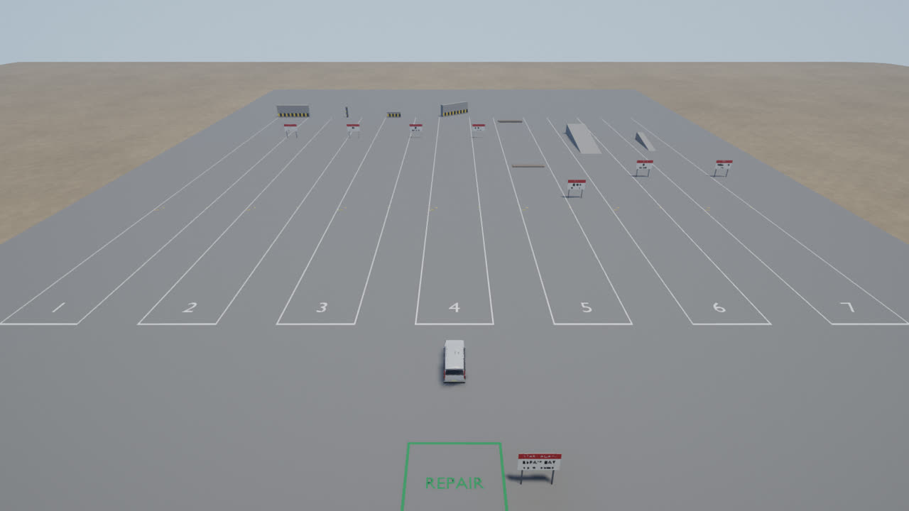
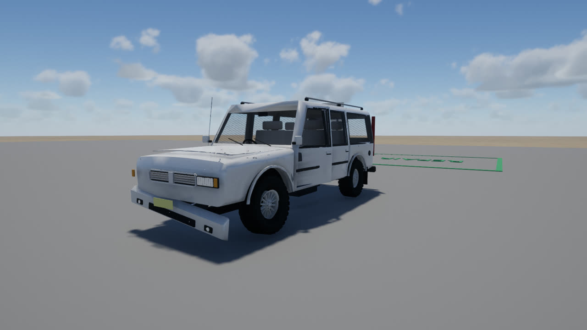
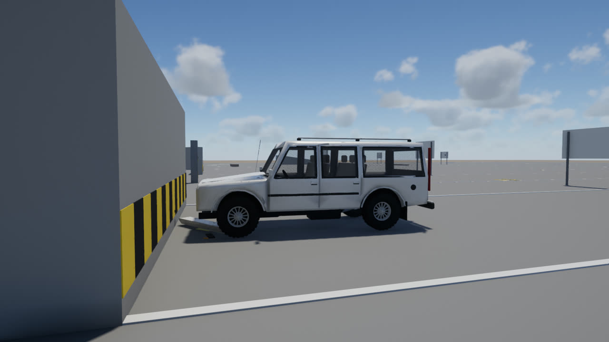

# Damage

What hitting things does to a truck, piece by piece, by how hard it was hit.

A truck is a kit of named pieces (`apps/viewer/src/kit.rs`). Each piece has its own
strength and goes through four stages as it is hit harder: **scuffed**, **dented**,
**loose** (hanging, and swinging as the truck moves) and **off** (lying where it fell).
Nothing counts hits. A piece's state is how hard it has been hit, in kilonewtons, and a tap
that would not mark it does nothing however often it is repeated.



## Trying it

```
crash.bat                          the crash-test pad, in the Howitt
crash.bat --kit bullbar=tube       the same truck with a bull bar on it
crash.bat --truck kestrel          another of the game's trucks (assets\trucks)
```

`crash.bat` makes the pad's model and bakes `scenes/damage.txt` to `assets/damage.solstice`
the first time, then runs `viewer assets\damage.solstice --play`. What each blow did is in
the window's title for eight seconds after it, and in `save\crash.log`, a line a piece:

```
damage: bumper_front is off (275 kN of a 277 kN blow)
```

The truck starts at the start line of lane 4. Each lane is 8 m wide and runs 90 m to its
test, with a yellow bar every 20 m that says how far there is to go.

| Lane | Test | What it is for |
| --- | --- | --- |
| 1 | Wall | The whole nose meets it: what is in front takes the blow first. |
| 2 | Post | A narrow part of the nose meets it: only what is near is hurt. |
| 3 | Offset | A block in front of the left of the nose: one side, and not the other. |
| 4 | Angled | The wall turned 35 degrees: a glancing blow down one corner. |
| 5 | Ledges | Rock steps of 20 cm and 40 cm: blows up through the wheels. |
| 6 | Drop | A ramp to 2.2 m and off the end: a hard landing. |
| 7 | Rollover | A ramp under the left wheels only: onto its side or its roof. |

To start again, stop in the green box behind the start line: the truck is mended there. A
truck that comes to rest on its side or its roof is stood back in the box by itself, after
two and a half seconds, mended. (A bay is an `actor damage/repair_bay.actor` line in a
scene; a scene without one never mends a truck by itself.)

For a picture with nothing driven, `--capture` takes two more options:

```
viewer assets\damage.solstice --play --fly --camera "-3.4,1.5,1.2,3.72,-0.1"
       --damage bumper_front=loose,lamp_head_R=off,bonnet=loose --capture out.png --frames 150
viewer ... --hit 0,0.9,-2.3,0,0,1,115 ...     a blow: where on the truck, the way it pushes, kN
```



## How a blow is measured

`crates/solstice-game/src/impact.rs`. Nothing is estimated from speed: the physics already
works out what every collision did to the truck, and that is what is used.

**What the body meets.** The truck's body is a box among the scene's walls, ground and
blockers. Each step the physics says how much hitting things changed the velocity of the
truck's centre of mass and its spin (`Physics::car_knock`). Times its mass and its inertia
that is the blow's impulse `J` and its turning impulse `L`. A push `J` at `r` from the
centre of mass turns the truck by `r × J = L`, so the two together give the line the blow
acted along, and where that line enters the body is where it landed. The steps of one blow
are summed, and it is told once it is over. What merely holds the truck up when it lies on
its belly or its roof (a step's worth of gravity, upward) is taken off first and is not a
blow.

The physics also says where the body is touching what it hit (`Physics::car_touches`). The
box round those places is the blow's **patch**: the whole nose against a wall, one end of
it against a post.

**What comes up through a wheel.** A wheel is a spring, not part of the box. What the four
wheels push the truck up with over a step is its mass times how hard it is pushed up
(`Telemetry::g`), shared among the wheels as each is loaded. More than three times what a
wheel carries standing still starts a blow to that wheel, and its impulse is what it pushed
with above its standing load until the load is back under 1.6 times.

**Force.** A blow's hardness is its impulse over a tenth of a second (`CRUSH_SECONDS`),
which is about how long a nose takes to fold against a wall. For scale, a two-tonne truck
stopped dead:

| Speed into a wall | Force |
| --- | --- |
| 10 km/h | 56 kN |
| 20 km/h | 111 kN |
| 40 km/h | 222 kN |
| 80 km/h | 444 kN |

Landing from 1 m puts about 34 kN through each front wheel, from 2.5 m about 72 kN.

`crates/solstice-game/tests/blows.rs` drives a truck into a wall and a post and drops it,
on the game's own physics, and holds the measurements to mass times speed.

## What a blow does

`apps/viewer/src/damage.rs`. Each piece has a box round it in the truck's own space. A
truck put together from its pack is measured as it is read (`kit::measured`, kept in
`NAME.actor.boxes`); one baked straight into a map is measured from the map.

1. **Which pieces feel it.** Those whose boxes are in the patch, looked at along the way
   the blow pushed, or within a margin of it: 12 cm, and 1.2 mm more for each kilonewton
   (`set reach`). A piece at the edge of the margin feels a share of the blow.
2. **In what order.** By how deep into the truck each piece's outer face is, along
   whichever of the truck's own axes the blow was most along. Pieces within 8 cm of each
   other are one layer (`set layer`) and feel the blow together.
3. **How much each feels.** The outermost layer feels all of it. Each piece takes out of
   the blow what it **soaks**, and the next layer feels what is left. A dented piece soaks
   0.7 of what it did, a loose one 0.3. So a bull bar spares the lamps behind it, and a
   blow that is hard enough goes through to the chassis.
4. **Glass** is not in the way of anything. It feels the whole blow, less with depth: none
   of it beyond 30 cm and 4 mm for each kilonewton (`set shock`).
5. **A blow through a wheel** goes to that corner's tyre, then its rim, then the suspension
   and the axle of that end, each soaking some. Nothing else feels it.
6. **What a piece keeps.** Its *hurt*: the hardest blow it has felt, plus a fifth
   (`set wear`) of each other blow that was hard enough to scuff it. Its stage is the last
   of its four thresholds its hurt has passed.

### The parts table

The numbers are one table, `PARTS` in `damage.rs`. A line is a kind of piece: the start of
its pieces' names (the longest that fits a piece wins, `*` is everything else), the force
at which it is scuffed, dented, loose and off (`-` for never), what it soaks, how it is
held on, and what it does.

```
#    kind               scuffed dented loose  off  soaks  held    does
part acc_bullbar_tube      35    110    240   360   110   bolted  -
part bumper                20     60    130   210    45   bolted  -
part lamp                  10     30     70   110     2   bolted  lamp
part grille                12     35     80   130     8   bolted  cooling
part nose                  25     70      -     -   100   frame   cooling
part door                  12     45    130   260    25   hinged  -
part mirror                 3      9     18    32     0   stalk   -
part glass                 15     30     55    55     0   glass   -
part tyre                  15     40     65     -     8   wheel   running
```

How a piece is held decides how it comes away:

| Held | Loose | Off |
| --- | --- | --- |
| `bolted` | Hangs by the end the blow did not land on | Falls |
| `hinged` | Its latch is gone: it swings on the kit's hinge | Falls |
| `lid` | A bonnet: lifts at its front, more the faster the truck goes | Falls |
| `stalk` | A mirror or an aerial: folded back | Falls |
| `glass` | Shows nothing | Gone |
| `wheel` | Buckled: tipped on its hub, so it wobbles as it turns | Never |
| `frame` | Never: the cab, nose and chassis only crumple | Never |

With the table as it stands, a two-tonne Howitt as it is sold, into the wall square on
(from the model's own reckoning, which `cargo test` holds it to):

| Speed | Bumper | Grille | Head lamps | Nose | Bonnet | Engine's pull left |
| --- | --- | --- | --- | --- | --- | --- |
| 10 km/h | scuffed | sound | scuffed | sound | sound | all |
| 20 km/h | dented | dented | dented: out | scuffed | sound | 0.85 |
| 30 km/h | loose | loose | off | dented | sound | 0.6 |
| 40 km/h | off | off | off | dented | dented | 0.35 |
| 80 km/h | off | off | off | dented | off | 0.35 |

At 80 km/h the chassis is dented and the windscreen is broken as well. With a tube bull
bar the bar is dented at 20 km/h and nothing else is touched; at 40 km/h the bar is dented,
the bumper, grille and lamps behind it are dented, and the engine has 0.85 of its pull.

Driven in the game at 47 km/h into the wall the blow measured 277 kN (the truck bounces
back a little, which adds to it): bumper, plate, grille, both head lamps and both indicators
off, the nose dented, the bonnet loose, the chassis scuffed.

## What it looks like

`damage::pose` gives how each hurt piece is moved from where it is when sound, and
`apps/viewer/src/wreck.rs` moves it.

- **Scuffed**: knocked a few millimetres out of line. There is no paint damage: see below.
- **Dented**: pushed in the way the blow pushed, 3 cm to 11 cm (`set dent`), tipped so the
  side that was hit goes in furthest, and shortened that way with its far side staying
  put. The cab, nose and chassis only shorten.
- **Loose**: as far in as a dent goes, and hanging. Doors and tailgates swing on their
  hinge, thrown about by the truck's own cornering and braking; a bonnet lifts with speed;
  a bumper droops by one end; a mirror folds back.
- **Off**: the piece's own instances are taken off the truck, fall, tumble and lie on
  whatever of the scene is under them. Nothing is made: it is the same piece.
- **Lamps** that are dented or worse are out, and the head lamps' beam is as bright as the
  share of them that still light.



**True mesh deformation is not done, and was not prototyped.** A truck's pieces are
virtual-geometry meshes: a hierarchy of clusters at several levels of detail, with points
on a 16-bit grid, spread over pages, and identical point blocks shared within a page. The
renderer can overwrite a page's points (`Renderer::rewrite_page`, which the nuggets use),
but only for a mesh built flat, with one level of detail and every page pinned. A dent
would have to be written into every level of detail of a piece alike, with cluster bounds
and normals that were fixed at the bake, and two trucks of one model share their meshes, so
a dent in one would show on the other. It would need trucks baked flat and a mesh each.
What is done instead is rigid pieces, moved and squashed.

## What it does to the driving

`Damage::handicap`, applied in the game's driving step (`drive::Handicap`):

- **Steering pull.** Each front tyre, rim, suspension or axle piece that is dented pulls
  the wheel 0.07 of full lock to its side, and each that is wrecked 0.16 (`set pull`), to
  0.45 at most. The driver holds against it.
- **Power.** With the grille or the nose dented the engine has 0.85 of its pull, with the
  grille loose 0.6, and with it gone 0.35 (`set power`): the radiator is behind it.

## The state, for a shop and a kept game

`Damage` is a list of hurt pieces, each with its hurt in kilonewtons, and where and which
way the hardest blow it has felt landed. As text it is a line a piece:

```
bumper_front 143.2 0.10 0.92 -2.32 0.000 0.000 1.000
```

| Call | For |
| --- | --- |
| `PlayMode::damage()` and `Damage::to_text()` | What a kept game keeps |
| `PlayMode::set_damage(text)` | Putting it back on the truck |
| `Damage::list(table)` | Each hurt piece and its stage: what a shop lists |
| `PlayMode::mend(piece)`, `PlayMode::repair()` | What a shop does |
| `PlayMode::take_damage_changes()` | What the last blows changed, to tell the player |

**In the game.** A truck of one's own stays hurt until it is mended. Whoever runs the game
gives the shell what blows have just changed (`Shell::see_damage`), which keeps the truck's
damage with it (`yard::Owned::damage`, a `damage=` word on its line of the kept game) and
tells the driver what the blow did for six seconds (`blow` in what the pages are told: the
worst three pieces, as a driver would say them). As a map is read the shell puts it back on
the truck (`Order::Damage`). Motor Spares mends it: **Repairs** is a line in the auto shop's
cart beside the oil change (`repair`), priced a piece by how far gone it is (`yard::REPAIRS`:
$40 scuffed, $150 dented, $280 loose, $480 torn off), and paid for on the bill like the
rest. A truck driven outside a story starts every map sound.

**Not done:** no page lists the hurt pieces one by one, and a piece cannot be mended by
itself from a page (`PlayMode::mend` is there for it).

## Adding a piece, or changing a number

- A new piece of a truck needs nothing if its name begins like a kind in the table: a
  `lamp_fog_L` is a `lamp`. Otherwise it is an ordinary bolted panel (`part *`).
- A new kind of piece is one `part` line in `PARTS`. Put its name's beginning, its four
  thresholds in rising order, what it soaks, `bolted`, `hinged`, `lid`, `stalk`, `glass`,
  `wheel` or `frame`, and `-`, `lamp`, `cooling` or `running`.
- To make something tougher, raise its thresholds. To make it protect what is behind it,
  raise what it soaks.
- `cargo test --release -p viewer --lib damage` runs the model's tests, which state what
  each speed into the wall does. A changed number that changes one of those fails there.

## What is not covered

- A truck with no kit (the Raptor) has no pieces and takes no damage.
- Fallen pieces are drawn, not solid: they do not stop a truck, and are driven through.
- The patch is a box round the places the truck's collision box touched, so a blow to a
  bumper that stands out in front of that box is told from the box's face behind it.
- A slow roll onto its side scuffs the doors and the cab. It does not take the mirror off,
  because the patch of the first touch is the body's lower edge.
- No sound is played for a blow, and nothing is drawn on the paint.
- The browser and Android builds get the damage (it is in the shared code), but the
  `--damage` and `--hit` picture options and the title readout are the desktop viewer's.
